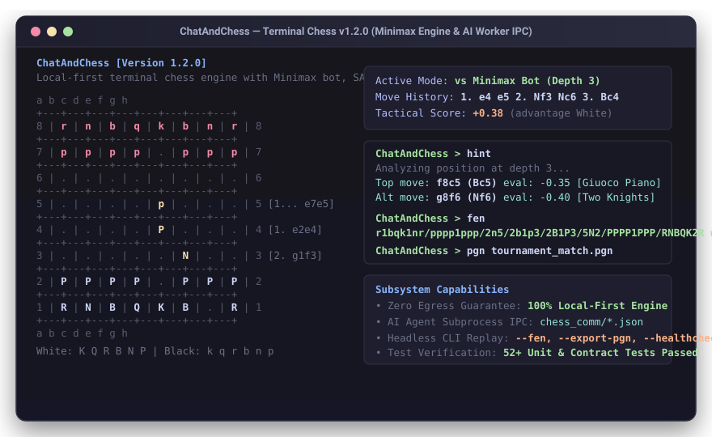
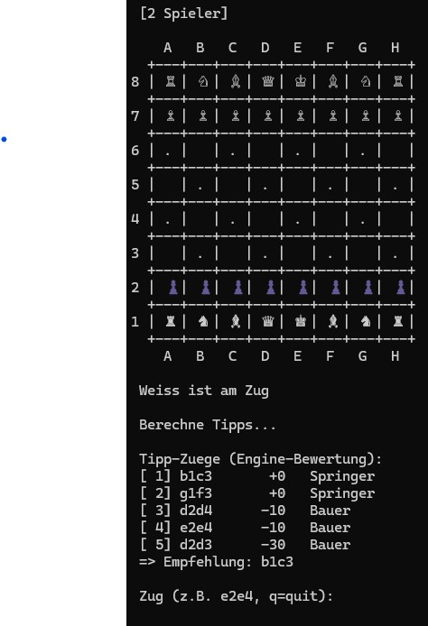
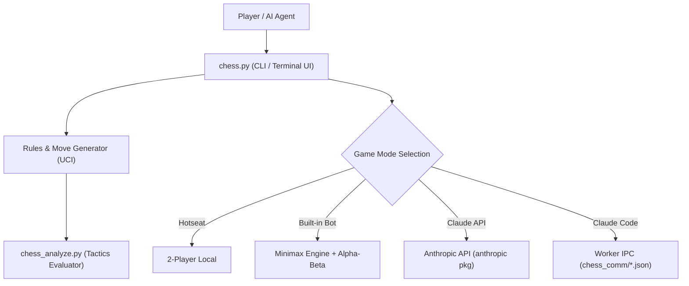
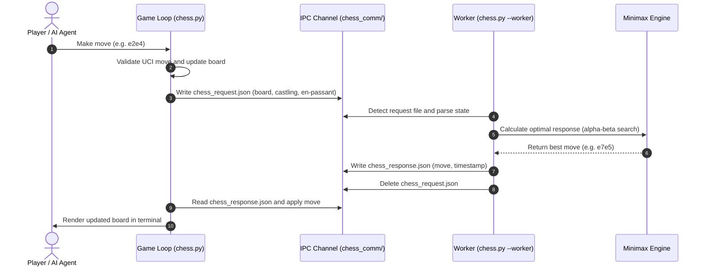

# ChatAndChess

[](https://github.com/entertain-and-more/ChatAndChess/actions/workflows/tests.yml)
[](tests/)
[](#)
[](https://www.python.org/)
[](LICENSE)
[](llms.txt)
[](https://github.com/astral-sh/ruff)
[](#requirements)
[](#game-state-export)
[](#privacy-security--zero-egress)
[](#)

[English](README.md) | [Deutsch](README_de.md)

Terminal chess for local games, a built-in Minimax bot, Claude API mode, and Claude Code worker integration.<br>
Terminal-Schach für lokale Partien, Minimax-Bot, Claude API und Claude-Code-Integration.

| Feature | Description |
| --- | --- |
| **Core Engine** | Pure Python 3.10+ implementation with zero required external dependencies |
| **Game Modes** | Hotseat (2P), Minimax Bot (depth 1–5), Claude API, Claude Code Worker IPC |
| **Rules Engine** | Castling, En Passant, Pawn Promotion, Check, Checkmate, and Stalemate |
| **Tactics Analyzer** | Position evaluator & candidate move ranker (`chess_analyze.py`) |
| **Worker Mode** | File/JSON-based subprocess interface for AI agents (`python chess.py --worker`) |
| **Export Formats** | Portable FEN string generation, tournament PGN & `chatandchess-game-v1.json` export |

> [!NOTE]
> **AI & LLM Integration**: ChatAndChess includes a specialized file-based `--worker` IPC mode designed for AI agents like Claude Code to play chess as background sub-processes without losing legal move context (such as castling rights & en-passant state). Machine-readable context is available in [llms.txt](llms.txt).

---

## Table of Contents

1. [Screenshots & Terminal Preview](#screenshots--terminal-preview)
2. [Architecture & Dataflow](#architecture--dataflow)
3. [Worker IPC Protocol Sequence](#worker-ipc-protocol-sequence)
4. [Features](#features)
5. [Target Personas & Use Cases](#target-personas--use-cases)
6. [Comparison Matrix](#comparison-matrix)
7. [Requirements](#requirements)
8. [Quick Start](#quick-start)
9. [How to Play](#how-to-play)
10. [Tactics Analyzer](#tactics-analyzer)
11. [Game State Export](#game-state-export)
12. [Tests & Verification](#tests--verification)
13. [Privacy, Security & Zero Egress](#privacy-security--zero-egress)
14. [Project Structure](#project-structure)
15. [Community Docs & Attribution](#community-docs--attribution)
16. [License & Liability](#license--liability)

---

## Screenshots & Terminal Preview



<br>



### Terminal Board Presentation

```text
    a   b   c   d   e   f   g   h
  +---+---+---+---+---+---+---+---+
8 | r | n | b | q | k | b | n | r | 8
  +---+---+---+---+---+---+---+---+
7 | p | p | p | p | p | p | p | p | 7
  +---+---+---+---+---+---+---+---+
6 | . | . | . | . | . | . | . | . | 6
  +---+---+---+---+---+---+---+---+
5 | . | . | . | . | . | . | . | . | 5
  +---+---+---+---+---+---+---+---+
4 | . | . | . | . | P | . | . | . | 4   [White: 1. e2e4]
  +---+---+---+---+---+---+---+---+
3 | . | . | . | . | . | . | . | . | 3
  +---+---+---+---+---+---+---+---+
2 | P | P | P | P | . | P | P | P | 2
  +---+---+---+---+---+---+---+---+
1 | R | N | B | Q | K | B | N | R | 1
  +---+---+---+---+---+---+---+---+
    a   b   c   d   e   f   g   h

  White: K=King Q=Queen R=Rook B=Bishop N=Knight P=Pawn
  Black: k=King q=Queen r=Rook b=Bishop n=Knight p=Pawn
```

---

## Architecture & Dataflow



---

## Worker IPC Protocol Sequence

The file-based `--worker` mode decouples the game presentation from the calculation engine, enabling AI agents and CLI sub-processes to interact cleanly via discrete JSON state snapshots:



---

## Features

- **4 Game Modes**
  - **2 Player**: Local hotseat game on one machine.
  - **vs Bot**: Built-in Minimax engine with configurable search depth (1–5).
  - **vs Claude API**: Optional game against Claude via the Anthropic API.
  - **vs Claude Code**: File-based worker communication for AI agents with persistent castling and en-passant state in worker JSON payloads.
- **Full Chess Rules**
  - Short and long castling, en passant captures, pawn promotion with piece selection, check detection, checkmate, and stalemate.
- **Engine Hints**
  - Equal hints (both sides), Engine mode (AI only), Training mode (human only), or Off (human mode).
- **Tactics & Position Analysis**
  - Piece-square positional heuristics, Alpha-Beta pruning, and a standalone tactics evaluator (`chess_analyze.py`).
- **Standardized Export Formats**
  - Direct conversion to FEN strings and structured `chatandchess-game-v1.json` export compatible with [EXPORTFORMAT.md](EXPORTFORMAT.md).

---

## Target Personas & Use Cases

| Persona | Primary Goal | How ChatAndChess Delivers |
|---|---|---|
| **[PERSONA-01] Terminal Minimalist** | Play chess quickly in a terminal without heavy GUIs or internet access. | Zero external dependencies, instant launch with `python chess.py`, works in any standard ANSI terminal. |
| **[PERSONA-02] AI Agent Developer** | Connect autonomous LLM agents (Claude Code, Codex) to a verified chess environment. | Stateless file IPC (`--worker`), explicit legal move list, verified castling/en-passant roundtrip. |
| **[PERSONA-03] Chess Analyst & Tactician** | Analyze move candidates and tactical lines offline. | Standalone CLI `chess_analyze.py` with custom search depth (`--depth`), top-N moves (`--top`), and evaluation scores. |
| **[PERSONA-04] Python Student / Educator** | Learn and inspect classical Minimax, Alpha-Beta pruning, and chess move generation. | Clean, readable Python 3.10+ standard library code without obscure C-extensions or complex framework wrappers. |

---

## Comparison Matrix

| Dimension | ChatAndChess | Heavyweight GUI Chess (PyChess, SCID) | Raw python-chess Library | Ad-hoc Terminal Scripts |
|---|---|---|---|---|
| **Dependency Footprint** | **0 required** (stdlib only) | Heavy (Qt, GTK, C-bindings) | Requires `pip install python-chess` | Varies, often unmaintained |
| **Terminal / CLI First** | Yes (clean ANSI / Unicode) | No (requires desktop window server) | No (library only, no interactive UI) | Partial |
| **Agent Worker IPC** | Yes (`chess_comm/` JSON protocol) | No | No | No |
| **Integrated Minimax Bot** | Yes (configurable depth 1–5) | External UCI engine required | Engine not bundled | Often basic or buggy |
| **Tactics Evaluator** | Yes (`chess_analyze.py`) | Yes (via UCI) | Code required | No |
| **Bilingual Documentation** | Yes (EN & DE parity) | English only | English only | Single language |
| **Offline & Zero Egress** | Yes (100% local-first) | Mostly offline | Offline | Varies |

---

## Requirements

- Python 3.10+
- Zero external dependencies for base terminal game
- Optional: `anthropic` package for Claude API mode (`pip install -r requirements.txt`)

```bash
pip install -r requirements.txt
```

---

## Quick Start

```bash
# Universal Windows launcher (auto-detects dist/ChatAndChess.exe or Python runtime)
start.bat

# Standard Python execution
python chess.py

# Windows interactive menu launcher
START_CHESS.bat

# Standalone executable verification (built via build_exe.bat)
dist\ChatAndChess.exe --healthcheck

# Worker mode for Claude Code / AI agents
python chess.py --worker
```

### Headless CLI & Scripting Interface

ChatAndChess provides non-interactive CLI flags including `--healthcheck`, `--fen`, `--export-pgn`, and `--version` for automated testing, CI pipelines, and scripting:

```bash
# Non-interactive engine assertion & healthcheck (validates board, moves, FEN, SAN)
python chess.py --healthcheck

# Replay moves and output resulting FEN string
python chess.py --fen e2e4 e7e5 g1f3 b8c6

# Replay moves and export full tournament PGN document
python chess.py --export-pgn game.pgn e2e4 e7e5 g1f3 b8c6 f1c4

# Export baseline initial game state to JSON
python chess.py --export-initial initial_board.json

# Display engine version information
python chess.py --version
```

---

## How to Play

Moves use standard UCI notation: `e2e4` (from-square to-square).

- Normal moves: `e2e4`, `g1f3`
- Castling: `e1g1` (short) or `e1c1` (long)
- Pawn promotion: Prompted automatically when reaching the 8th (or 1st) rank, e.g. `e7e8q`

### In-Game Console Commands

During any interactive game, enter these commands directly at the prompt:

| Command | Action | Example |
|---|---|---|
| `fen` | Print current board in FEN notation | `fen` |
| `export` / `export [path]` | Export current game state to JSON with SAN notation | `export my_game.json` |
| `pgn` / `pgn [path]` | Export full move history to standardized PGN file | `pgn match.pgn` |
| `hint` / `tipp` | Calculate tactical recommendation at active bot depth | `hint` |
| `help` / `?` | Display available game controls and commands | `help` |
| `quit` / `exit` | Exit the current game session safely | `quit` |

---

## Tactics Analyzer

> [!TIP]
> Use `chess_analyze.py` to evaluate arbitrary positions, compare top candidate moves, or verify move sequences offline.

```bash
# Analyze current position
python chess_analyze.py

# Custom search depth (e.g. depth 4)
python chess_analyze.py --depth 4

# Analyze a specific move sequence
python chess_analyze.py e2e4 e7e5 g1f3

# Show top 8 candidate moves
python chess_analyze.py --top 8
```

---

## Game State Export

ChatAndChess implements standardized game exports documented in [EXPORTFORMAT.md](EXPORTFORMAT.md):

- **FEN Format**: Generated via `chess.board_to_fen()` for seamless interoperability with Lichess, Chess.com, and analysis tools.
- **Application JSON**: `chatandchess-game-v1.json` generated via `chess.build_game_export()` capturing full game history, active mode, and board state without cloud dependency.

---

## Tests & Verification

The test suite covers move generation, castling rights, en-passant persistence, worker IPC payloads, export formatting, and platform smoke verification:

```bash
# Run unit test suite (31 tests)
python -m unittest discover -s tests -p "test_*.py"

# Python syntax compilation check
python -m py_compile chess.py chess_analyze.py

# Platform smoke test (worker boot, analyzer, quit)
python tests/source_platform_smoke.py

# Code style audit
ruff check .
```

---

## Privacy, Security & Zero Egress

ChatAndChess operates 100% locally by default. API keys belong in the `ANTHROPIC_API_KEY` environment variable or a local key file, never in this repository.

Ignored local files:
- `.env`, `.env.*`, `.anthropic_key`, credentials & tokens
- `chess_settings.json`
- `CLAUDE_PROMPT.txt`
- `chess_comm/` (runtime worker directory)
- Build outputs (`build/`, `dist/`, `*.exe`, `*.msi`)
- Local database/cache outputs (`*.db`, `.pytest_cache/`, `.ruff_cache/`)

---

## Project Structure

```
chess.py                  Main game (all modes, engine, rules, worker interface)
chess_analyze.py          Tactics analyzer (position evaluation, candidate moves)
pyproject.toml            PEP 621 package & test metadata
START_CHESS.bat           Windows launcher
build_exe.bat             Optional PyInstaller build helper for Windows
requirements.txt          Base / optional dependency notes
EXPORTFORMAT.md           Game export specification (FEN & JSON)
NOTICE                    Copyright & attribution notice
THIRD_PARTY_LICENSES.md   Level 1 SBOM & runtime invariants
tests/
  test_bugsweep_regressions.py  Rules & move generation regressions (10 tests)
  test_export.py                FEN & game export tests (5 tests)
  test_worker_state.py          Worker IPC roundtrip & castling tests (5 tests)
  source_platform_smoke.py      Platform smoke test
  test_metadata.py              Documentation & contract parity tests
README/screenshots/       Repository screenshots
chess_comm/               Runtime IPC communication directory (gitignored)
chess_settings.json       Local game settings (gitignored)
```

---

## Community Docs & Attribution

- [Contributing](CONTRIBUTING.md)
- [Code of Conduct](CODE_OF_CONDUCT.md)
- [Security Policy](SECURITY.md)
- [Changelog](CHANGELOG.md)
- [LLM Context](llms.txt)
- [Attribution Notice](NOTICE)
- [Third-Party Licenses & SBOM](THIRD_PARTY_LICENSES.md)

---

## License & Liability

[MIT License](LICENSE) — Copyright (c) 2026 Lukas Geiger.

Dieses Projekt ist eine **unentgeltliche Open-Source-Schenkung** im Sinne der §§ 516 ff. BGB. Die Haftung des Urhebers ist gemäß **§ 521 BGB** auf **Vorsatz und grobe Fahrlässigkeit** beschränkt. Ergänzend gelten die Haftungsausschlüsse der MIT-Lizenz.

Nutzung auf eigenes Risiko. Keine Wartungszusage, keine Verfügbarkeitsgarantie, keine Gewähr für Fehlerfreiheit oder Eignung für einen bestimmten Zweck.

This project is an unpaid open-source donation. Liability is limited to intent and gross negligence (§ 521 German Civil Code). Use at your own risk. No warranty, no maintenance guarantee, no fitness-for-purpose assumed.
