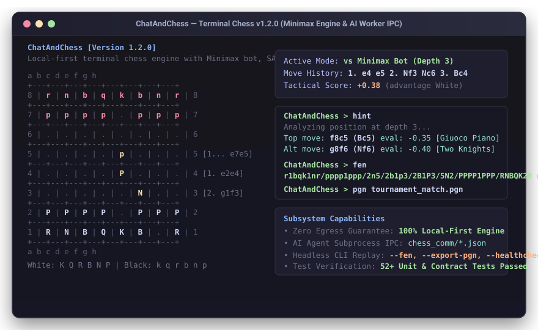
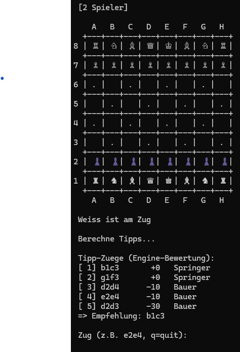
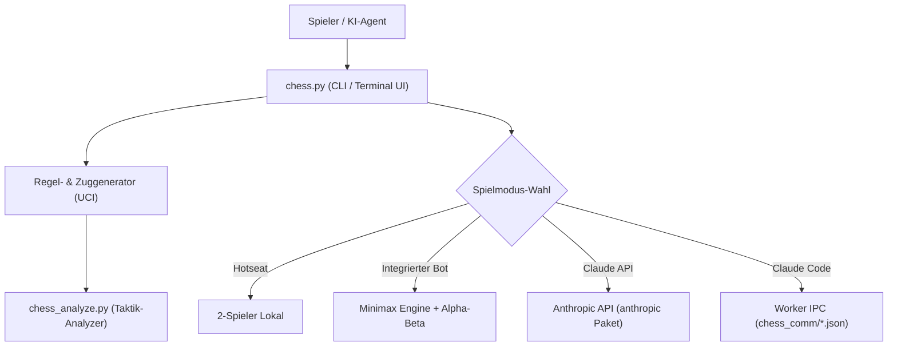
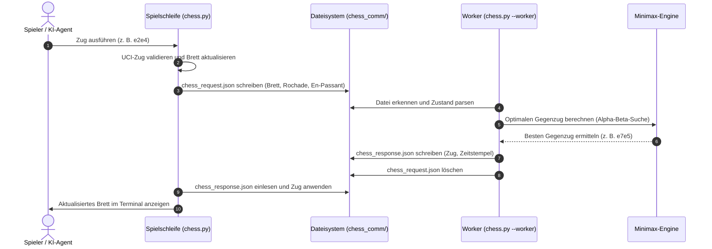

# ChatAndChess (Deutsch)

[](https://github.com/entertain-and-more/ChatAndChess/actions/workflows/tests.yml)
[](tests/)
[](#)
[](https://www.python.org/)
[](LICENSE)
[](llms.txt)
[](https://github.com/astral-sh/ruff)
[](#voraussetzungen)
[](#spielstand-export)
[](#datenschutz-sicherheit--zero-egress)
[](#)

[English](README.md) | [Deutsch](README_de.md) | [Español](README_es.md)

Terminal-Schach in Python für lokale Partien, Minimax-Bot, Claude API und Claude-Code-Integration.

| Funktion | Beschreibung |
| --- | --- |
| **Kern-Engine** | Reine Python 3.10+ Implementierung ohne zwingende externe Abhängigkeiten |
| **Spielmodi** | Hotseat (2-Spieler), Minimax-Bot (Tiefe 1–5), Claude API, Claude Code Worker IPC |
| **Regel-Engine** | Rochade, En Passant, Bauernumwandlung, Schach, Matt und Patt |
| **Taktik-Analyzer** | Stellungsbewertung & Kandidatenzug-Ranking (`chess_analyze.py`) |
| **Worker-Modus** | Dateibasierte Subprozess-Schnittstelle für KI-Agenten (`python chess.py --worker`) |
| **Export-Formate** | Portable FEN-Generierung, Turnier-PGN & `chatandchess-game-v1.json`-Export |

> [!NOTE]
> **KI- & LLM-Integration**: ChatAndChess enthält einen spezialisierten `--worker`-IPC-Modus, mit dem KI-Agenten wie Claude Code als Hintergrundprozess Schach spielen können, ohne legale Zug-Kontexte (wie Rochaderechte & En-Passant-Status) zu verlieren. Maschinenlesbare Spezifikationen sind in [llms.txt](llms.txt) hinterlegt.

---

## Inhaltsverzeichnis

1. [Screenshots & Terminal-Vorschau](#screenshots--terminal-vorschau)
2. [Architektur & Datenfluss](#architektur--datenfluss)
3. [Worker-IPC-Protokoll & Ablauf](#worker-ipc-protokoll--ablauf)
4. [Funktionen](#funktionen)
5. [Ziel-Personas & Anwendungsfälle](#ziel-personas--anwendungsfälle)
6. [Vergleichsmatrix](#vergleichsmatrix)
7. [Voraussetzungen](#voraussetzungen)
8. [Schnellstart](#schnellstart)
9. [Spielweise](#spielweise)
10. [Taktik-Analyzer](#taktik-analyzer)
11. [Spielstand-Export](#spielstand-export)
12. [Tests & Verifikation](#tests--verifikation)
13. [Datenschutz, Sicherheit & Zero Egress](#datenschutz-sicherheit--zero-egress)
14. [Projektstruktur](#projektstruktur)
15. [Community-Dokumentation & Attribution](#community-dokumentation--attribution)
16. [Haftungsausschluss](#haftungsausschluss)

---

## Screenshots & Terminal-Vorschau



<br>



### Terminal-Brett-Darstellung

```text
    a   b   c   d   e   f   g   h
  +---+---+---+---+---+---+---+---+
8 | r | n | b | q | k | b | n | r | 8
  +---+---+---+---+---+---+---+---+
7 | p | p | p | p | p | p | p | p | 7
  +---+---+---+---+---+---+---+---+
6 | . | . | . | . | . | . | . | . | 6
  +---+---+---+---+---+---+---+---+
5 | . | . | . | . | . | . | . | . | 5
  +---+---+---+---+---+---+---+---+
4 | . | . | . | . | P | . | . | . | 4   [Weiß: 1. e2e4]
  +---+---+---+---+---+---+---+---+
3 | . | . | . | . | . | . | . | . | 3
  +---+---+---+---+---+---+---+---+
2 | P | P | P | P | . | P | P | P | 2
  +---+---+---+---+---+---+---+---+
1 | R | N | B | Q | K | B | N | R | 1
  +---+---+---+---+---+---+---+---+
    a   b   c   d   e   f   g   h

  Weiß: K=König Q=Dame R=Turm B=Läufer N=Springer P=Bauer
  Schwarz: k=König q=Dame r=Turm b=Läufer n=Springer p=Bauer
```

---

## Architektur & Datenfluss



---

## Worker-IPC-Protokoll & Ablauf

Der dateibasierte `--worker`-Modus entkoppelt die Spielanzeige von der Berechnungs-Engine. Dadurch können KI-Agenten und CLI-Subprozesse sauber über diskrete JSON-Zustandsabbilder interagieren:



---

## Funktionen

- **4 Spielmodi**
  - **2 Player**: Lokales Hotseat-Spiel für zwei Personen an einem Rechner.
  - **vs Bot**: Integrierte Minimax-Engine mit konfigurierbarer Suchtiefe (1–5).
  - **vs Claude API**: Optionales Spiel gegen Claude über die offizielle Anthropic-API.
  - **vs Claude Code**: Dateibasierte Worker-Kommunikation für KI-Agenten mit dauerhafter Erhaltung von Rochade- und En-Passant-Rechten im Worker-JSON.
- **Vollständige Schachregeln**
  - Kurze und lange Rochade, En-Passant-Schlagzüge, Bauernumwandlung mit Figurenwahl, Schach-Erkennung, Matt und Patt.
- **Engine-Hilfen**
  - Gleichzug-Modus (beide Seiten sehen Hinweise), Engine-Modus (nur KI), Training-Modus (nur Mensch), Mensch-Modus (keine Hinweise).
- **Taktik & Stellungsanalyse**
  - Piece-Square-Tabellen, Alpha-Beta-Pruning und eigenständiger Taktik-Analyzer (`chess_analyze.py`).
- **Standardisierte Exportformate**
  - Direkte Erzeugung von FEN-Zeichenketten und strukturierter `chatandchess-game-v1.json`-Export gemäß [EXPORTFORMAT.md](EXPORTFORMAT.md).

---

## Ziel-Personas & Anwendungsfälle

| Persona | Primäres Ziel | Nutzen durch ChatAndChess |
|---|---|---|
| **[PERSONA-01] Terminal-Minimalist** | Schnell eine Partie Schach im Terminal ohne Ballast oder Internetverbindung spielen. | Keine externen Abhängigkeiten, sekundenschneller Start mit `python chess.py`, läuft in jedem Standard-Terminal. |
| **[PERSONA-02] KI-Agenten-Entwickler** | Autonome LLM-Agenten (Claude Code, Codex) an eine verifizierte Schachumgebung anbinden. | Zustandsloses Datei-IPC (`--worker`), explizite legale Züge, verifizierter Rochade- und En-Passant-Roundtrip. |
| **[PERSONA-03] Schach-Analyst & Taktiker** | Kandidatenzüge und taktische Varianten offline berechnen und vergleichen. | Eigenständiges CLI-Tool `chess_analyze.py` mit frei wählbarer Suchtiefe (`--depth`), Top-N-Zügen (`--top`) und Stellungsbewertung. |
| **[PERSONA-04] Python-Lernende & Lehrende** | Klassische Minimax-Algorithmen, Alpha-Beta-Pruning und Zuggenerierung studieren. | Sauberer, leicht lesbarer Python 3.10+ Standardbibliothekscode ohne C-Extensions oder komplexe Framework-Abstraktionen. |

---

## Vergleichsmatrix

| Kriterium | ChatAndChess | Schwergewichtige GUI-Programme (PyChess, SCID) | Reine python-chess Bibliothek | Ad-hoc Terminal-Skripte |
|---|---|---|---|---|
| **Abhängigkeiten** | **0 zwingend** (nur Standard-Lib) | Schwer (Qt, GTK, C-Bindings) | Erfordert `pip install python-chess` | Variiert, oft ungepflegt |
| **Terminal / CLI-Fokus** | Ja (saubere ANSI/Unicode-Ausgabe) | Nein (benötigt Desktop-Umgebung) | Nein (nur Bibliothek, keine UI) | Teilweise |
| **Agent-Worker IPC** | Ja (`chess_comm/` JSON-Protokoll) | Nein | Nein | Nein |
| **Integrierter Minimax-Bot** | Ja (Suchtiefe 1–5 wählbar) | Externe UCI-Engine erforderlich | Keine Engine enthalten | Oft simpel oder fehlerhaft |
| **Taktik-Analyzer** | Ja (`chess_analyze.py`) | Ja (über UCI) | Code erforderlich | Nein |
| **Zweisprachige Doku** | Ja (vollständige DE/EN-Parität) | Nur Englisch | Nur Englisch | Meist einsprachig |
| **Offline & Zero Egress** | Ja (100% lokal) | Meist offline | Offline | Variiert |

---

## Voraussetzungen

- Python 3.10+
- Keine externen Abhängigkeiten für das Basis-Terminalspiel
- Optional: Paket `anthropic` für den Claude-API-Modus (`pip install -r requirements.txt`)

```bash
pip install -r requirements.txt
```

---

## Schnellstart

```bash
# Universeller Windows-Starter (erkennt dist\ChatAndChess.exe oder Python-Laufzeit)
start.bat

# Standard-Start via Python
python chess.py

# Windows-Menüstarter
START_CHESS.bat

# Eigenständige EXE-Version prüfen (gebaut via build_exe.bat)
dist\ChatAndChess.exe --healthcheck

# Worker-Modus für Claude Code / KI-Agenten
python chess.py --worker
```

### Headless-CLI & Skript-Schnittstelle

ChatAndChess bietet nicht-interaktive CLI-Parameter für automatisiertes Testen, CI-Pipelines und Skripte:

```bash
# Engine-Selbsttest & Healthcheck (validiert Brett, Züge, FEN, SAN)
python chess.py --healthcheck

# Züge nachspielen und resultierende FEN-Zeichenkette ausgeben
python chess.py --fen e2e4 e7e5 g1f3 b8c6

# Züge nachspielen und PGN-Turnierdokument exportieren
python chess.py --export-pgn partie.pgn e2e4 e7e5 g1f3 b8c6 f1c4

# Ausgangsstellung als JSON exportieren
python chess.py --export-initial initial_board.json

# Versionsinformationen anzeigen
python chess.py --version
```

---

## Spielweise

Züge werden in standardisierter UCI-Notation eingegeben: `e2e4` (Startfeld zu Zielfeld).

- Normale Züge: `e2e4`, `g1f3`
- Rochade: `e1g1` (kurz) oder `e1c1` (lang)
- Bauernumwandlung: Beim Erreichen der 8. (bzw. 1.) Reihe fragt das Programm nach der gewünschten Figur, z. B. `e7e8q`

### Konsolen-Befehle im Spiel

Während einer laufenden Partie können folgende Befehle direkt an der Eingabeaufforderung eingegeben werden:

| Befehl | Aktion | Beispiel |
|---|---|---|
| `fen` | Gibt die aktuelle Stellung in FEN-Notation aus | `fen` |
| `export` / `export [pfad]` | Exportiert den aktuellen Spielstand als JSON mit SAN-Notation | `export partie.json` |
| `pgn` / `pgn [pfad]` | Exportiert die gesamte Partie als PGN-Turnierdokument | `pgn partie.pgn` |
| `hint` / `tipp` | Berechnet taktischen Zugvorschlag auf der aktuellen Bot-Tiefe | `hint` |
| `help` / `?` | Zeigt interaktive Hilfe und Steuerungsbefehle | `help` |
| `lang [code]` / `sprache [code]` | Zeigt oder wechselt die Anzeigesprache während der Partie | `lang de` |
| `quit` / `exit` | Beendet die Spielsitzung sicher | `quit` |

---

## Taktik-Analyzer

> [!TIP]
> Verwende `chess_analyze.py`, um beliebige Positionen zu bewerten, Top-Kandidatenzüge zu vergleichen oder Zugfolgen offline zu verifizieren.

```bash
# Aktuelle Position analysieren
python chess_analyze.py

# Eigene Suchtiefe (z. B. Tiefe 4)
python chess_analyze.py --depth 4

# Zugfolge analysieren
python chess_analyze.py e2e4 e7e5 g1f3

# Mehr Kandidatenzüge anzeigen
python chess_analyze.py --top 8
```

---

## Spielstand-Export

ChatAndChess unterstützt standardisierte Exportformate gemäß [EXPORTFORMAT.md](EXPORTFORMAT.md):

- **FEN-Format**: Generierbar über `chess.board_to_fen()` für nahtlosen Austausch mit Lichess, Chess.com und Analysetools.
- **Anwendungs-JSON**: `chatandchess-game-v1.json` erzeugbar über `chess.build_game_export()`, um Spielhistorie, Spielmodus und Brettzustand ohne Cloud-Zwang zu speichern.

---

## Tests & Verifikation

Die Test-Suite verifiziert Zuggenerierung, Rochaderechte, En-Passant-Zustände, Worker-IPC-Payloads, Exportformate und Plattform-Smoketests:

```bash
# Unit-Testsuite ausführen (31 Tests)
python -m unittest discover -s tests -p "test_*.py"

# Python Syntax-Kompilierung prüfen
python -m py_compile chess.py chess_analyze.py

# Plattform-Smoketest ausführen
python tests/source_platform_smoke.py

# Code-Stil prüfen
ruff check .
```

---

## Datenschutz, Sicherheit & Zero Egress

ChatAndChess speichert Spiel- und Worker-Laufzeitdaten lokal. API-Schlüssel gehören in die Umgebungsvariable `ANTHROPIC_API_KEY` oder in eine lokale Key-Datei, aber nicht in dieses Repository.

Ignorierte lokale Dateien:
- `.env`, `.env.*`, `.anthropic_key`, Credential- & Token-Dateien
- `chess_settings.json`
- `CLAUDE_PROMPT.txt`
- `chess_comm/` (Laufzeit-Kommunikationsverzeichnis)
- Build-Outputs (`build/`, `dist/`, `*.exe`, `*.msi`)
- Lokale Datenbank- & Cache-Dateien (`*.db`, `.pytest_cache/`, `.ruff_cache/`)

---

## Projektstruktur

```
chess.py                  Hauptspiel (alle Modi, Engine, Regeln, Worker-Interface)
chess_analyze.py          Taktik-Analyzer (Stellungsbewertung, Kandidatenzüge)
pyproject.toml            PEP 621 Paket- & Test-Metadaten
START_CHESS.bat           Windows-Starter
build_exe.bat             Optionaler PyInstaller-Build-Helfer für Windows
requirements.txt          Basis / optionale Abhängigkeiten
EXPORTFORMAT.md           Spezifikation des Spielstand-Exports (FEN & JSON)
NOTICE                    Urheberrechts- und Attributions-Hinweis
THIRD_PARTY_LICENSES.md   Level 1 SBOM & Laufzeit-Invarianten
tests/
  test_bugsweep_regressions.py  Regel- & Zuggenerierungs-Regressionen (10 Tests)
  test_export.py                FEN- & Export-Tests (5 Tests)
  test_worker_state.py          Worker-IPC-Roundtrip- & Rochade-Tests (5 Tests)
  source_platform_smoke.py      Plattform-Smoke-Test
  test_metadata.py              Dokumentations- & Vertragstests
README/screenshots/       Repository-Screenshots
chess_comm/               Laufzeit-IPC-Verzeichnis (gitignored)
chess_settings.json       Lokale Spieleinstellungen (gitignored)
```

---

## Community-Dokumentation & Attribution

- [Mitwirken](CONTRIBUTING.md)
- [Verhaltenskodex](CODE_OF_CONDUCT.md)
- [Sicherheitsrichtlinie](SECURITY.md)
- [Änderungsprotokoll](CHANGELOG.md)
- [LLM-Kontext](llms.txt)
- [Attributions-Hinweis](NOTICE)
- [Drittanbieter-Lizenzen & SBOM](THIRD_PARTY_LICENSES.md)

---

## Haftungsausschluss

[MIT License](LICENSE) — Copyright (c) 2026 Lukas Geiger.

Dieses Projekt ist eine **unentgeltliche Open-Source-Schenkung** im Sinne der §§ 516 ff. BGB. Die Haftung des Urhebers ist gemäß **§ 521 BGB** auf **Vorsatz und grobe Fahrlässigkeit** beschränkt. Ergänzend gelten die Haftungsausschlüsse der MIT-Lizenz.

Nutzung auf eigenes Risiko. Keine Wartungszusage, keine Verfügbarkeitsgarantie, keine Gewähr für Fehlerfreiheit oder Eignung für einen bestimmten Zweck.

This project is an unpaid open-source donation. Liability is limited to intent and gross negligence (§ 521 German Civil Code). Use at your own risk. No warranty, no maintenance guarantee, no fitness-for-purpose assumed.
