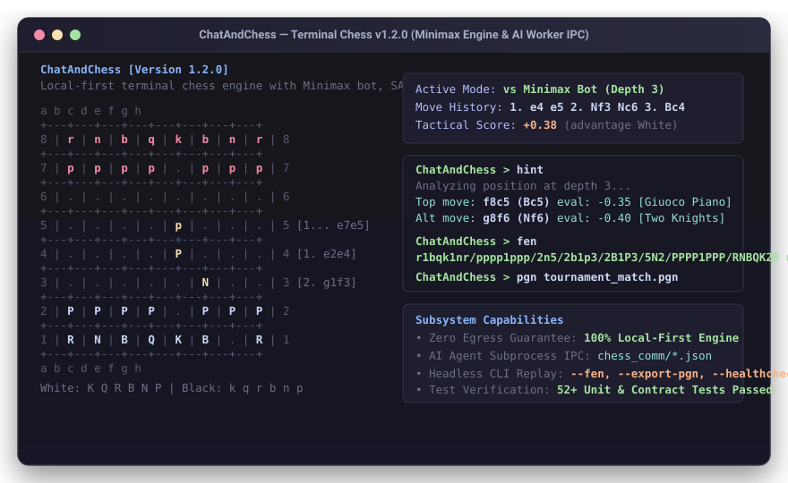
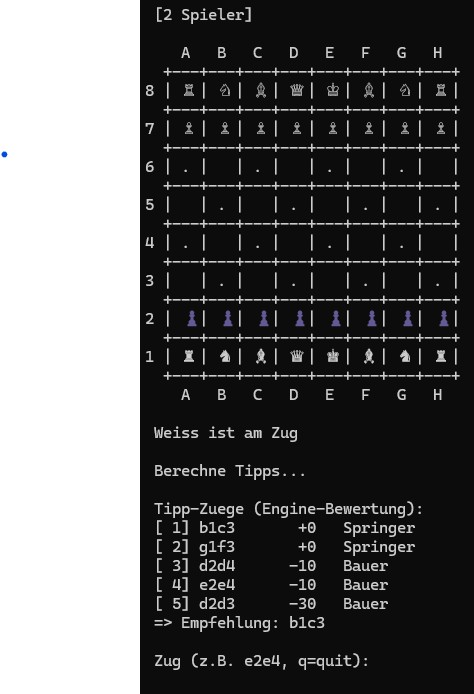
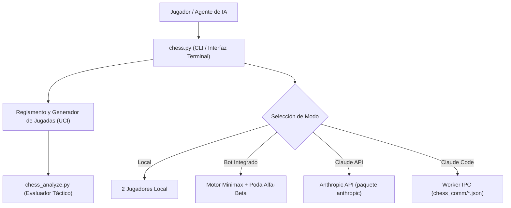
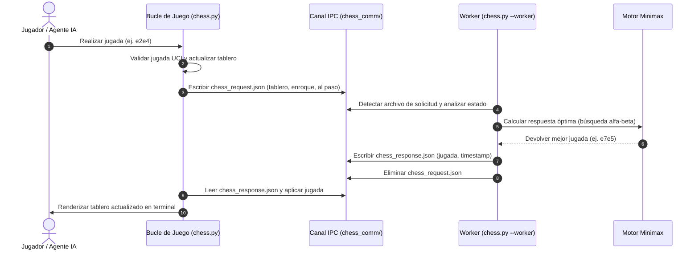

# ChatAndChess (Español)

[](https://github.com/entertain-and-more/ChatAndChess/actions/workflows/tests.yml)
[](tests/)
[](#)
[](https://www.python.org/)
[](LICENSE)
[](llms.txt)
[](https://github.com/astral-sh/ruff)
[](#requisitos)
[](#)

[English](README.md) | [Deutsch](README_de.md) | [Español](README_es.md)

Ajedrez de terminal para partidas locales, bot Minimax integrado, modo Claude API e integración de worker para Claude Code.<br>
Terminal chess for local games, built-in Minimax bot, Claude API, and Claude Code worker integration.

| Característica | Descripción |
| --- | --- |
| **Motor Principal** | Implementación pura en Python 3.10+ sin dependencias externas obligatorias |
| **Modos de Juego** | Local 2 Jugadores, Bot Minimax (profundidad 1–5), Claude API, Worker IPC para Claude Code |
| **Reglamento Completo** | Enroque, captura al paso, coronación de peón, jaque, jaque mate y tablas por ahogado |
| **Analizador Táctico** | Evaluador de posiciones y clasificador de movimientos candidatos (`chess_analyze.py`) |
| **Modo Worker** | Interfaz por subprocesos basada en archivos JSON para agentes de IA (`python chess.py --worker`) |
| **Formatos de Exportación** | Generación de cadenas FEN, PGN estándar de torneo y formato `chatandchess-game-v1.json` |

> [!NOTE]
> **Integración con IA y LLM**: ChatAndChess incluye un modo especializado IPC `--worker` basado en archivos, diseñado para que agentes de IA como Claude Code jueguen ajedrez como subprocesos en segundo plano sin perder el contexto reglamentario (como derechos de enroque y peones al paso). La especificación legible por máquinas está disponible en [llms.txt](llms.txt).

---

## Tabla de Contenidos

1. [Capturas de Pantalla y Vista Previa](#capturas-de-pantalla-y-vista-previa)
2. [Arquitectura y Flujo de Datos](#arquitectura-y-flujo-de-datos)
3. [Secuencia del Protocolo IPC del Worker](#secuencia-del-protocolo-ipc-del-worker)
4. [Características](#características)
5. [Personas Objetivo y Casos de Uso](#personas-objetivo-y-casos-de-uso)
6. [Matriz Comparativa](#matriz-comparativa)
7. [Requisitos](#requisitos)
8. [Inicio Rápido](#inicio-rápido)
9. [Cómo Jugar](#cómo-jugar)
10. [Analizador Táctico](#analizador-táctico)
11. [Exportación del Estado de Juego](#exportación-del-estado-de-juego)
12. [Pruebas y Verificación](#pruebas-y-verificación)
13. [Privacidad, Seguridad y Zero Egress](#privacidad-seguridad-y-zero-egress)
14. [Estructura del Proyecto](#estructura-del-proyecto)
15. [Documentación de la Comunidad y Atribución](#documentación-de-la-comunidad-y-atribución)
16. [Licencia y Responsabilidad](#licencia-y-responsabilidad)

---

## Capturas de Pantalla y Vista Previa



<br>



### Representación del Tablero en Terminal

```text
    a   b   c   d   e   f   g   h
  +---+---+---+---+---+---+---+---+
8 | r | n | b | q | k | b | n | r | 8
  +---+---+---+---+---+---+---+---+
7 | p | p | p | p | p | p | p | p | 7
  +---+---+---+---+---+---+---+---+
6 | . | . | . | . | . | . | . | . | 6
  +---+---+---+---+---+---+---+---+
5 | . | . | . | . | . | . | . | . | 5
  +---+---+---+---+---+---+---+---+
4 | . | . | . | . | P | . | . | . | 4   [Blancas: 1. e2e4]
  +---+---+---+---+---+---+---+---+
3 | . | . | . | . | . | . | . | . | 3
  +---+---+---+---+---+---+---+---+
2 | P | P | P | P | . | P | P | P | 2
  +---+---+---+---+---+---+---+---+
1 | R | N | B | Q | K | B | N | R | 1
  +---+---+---+---+---+---+---+---+
    a   b   c   d   e   f   g   h

  Blancas: K=Rey Q=Dama R=Torre B=Alfil N=Caballo P=Peón
  Negras:  k=Rey q=Dama r=Torre b=Alfil n=Caballo p=Peón
```

---

## Arquitectura y Flujo de Datos



---

## Secuencia del Protocolo IPC del Worker

El modo `--worker` desacopla la presentación del juego del motor de cálculo, permitiendo que agentes de IA y subprocesos interactúen limpiamente mediante instantáneas JSON de estado:



---

## Características

- **4 Modos de Juego**
  - **2 Jugadores**: Partida local por turnos en el mismo terminal.
  - **vs Bot**: Motor Minimax integrado con profundidad de búsqueda configurable (1–5).
  - **vs Claude API**: Partida opcional contra Claude mediante la API de Anthropic.
  - **vs Claude Code**: Comunicación por archivos para agentes de IA con preservación persistente del estado de enroque y capturas al paso.
- **Reglamento Completo del Ajedrez**
  - Enroque corto y largo, capturas al paso, coronación de peón con selección interactiva, detección de jaque, jaque mate y tablas por ahogado.
- **Consejos Tácticos del Motor**
  - Consejos equilibrados (ambos lados), modo motor (solo IA), modo entrenamiento (solo humano) o desactivado.
- **Análisis Táctico y de Posición**
  - Tablas posicionales pieza-casilla, poda Alfa-Beta y evaluador táctico independiente (`chess_analyze.py`).
- **Formatos de Exportación Estandarizados**
  - Conversión directa a notación FEN, exportación PGN y JSON estructurado compatible con [EXPORTFORMAT.md](EXPORTFORMAT.md).
- **Internacionalización Tier-2 (Policy P-006)**
  - Soporte completo en 6 idiomas: Alemán (de), Inglés (en), Español (es), Chino simplificado (zh), Japonés (ja) y Ruso (ru).

---

## Personas Objetivo y Casos de Uso

| Persona | Objetivo Principal | Beneficio de ChatAndChess |
|---|---|---|
| **[PERSONA-01] Minimalista de Terminal** | Jugar al ajedrez rápidamente en la terminal sin interfaces gráficas pesadas ni conexión a internet. | Cero dependencias externas obligatorias, inicio instantáneo con `python chess.py`, compatible con cualquier terminal ANSI. |
| **[PERSONA-02] Desarrollador de Agentes de IA** | Conectar agentes LLM autónomos (Claude Code, Codex) a un entorno de ajedrez verificado. | IPC sin estado basado en archivos (`--worker`), lista explícita de movimientos legales, ciclo completo de enroque y al paso verificado. |
| **[PERSONA-03] Analista Táctico de Ajedrez** | Analizar variantes y líneas tácticas sin conexión. | CLI independiente `chess_analyze.py` con profundidad configurable (`--depth`), candidatos principales (`--top`) y puntuaciones. |
| **[PERSONA-04] Estudiante / Docente de Python** | Aprender e inspeccionar algoritmos clásicos de Minimax, poda Alfa-Beta y generación de movimientos. | Código limpio y legible en biblioteca estándar de Python 3.10+ sin extensiones complejas en C ni frameworks opacos. |

---

## Matriz Comparativa

| Dimensión | ChatAndChess | Software GUI Pesado (PyChess, SCID) | Biblioteca python-chess pura | Scripts improvisados de terminal |
|---|---|---|---|---|
| **Dependencias** | **0 obligatorias** (solo biblioteca estándar) | Pesadas (Qt, GTK, C-bindings) | Requiere `pip install python-chess` | Variable, a menudo sin mantenimiento |
| **Terminal / CLI First** | Sí (ANSI / Unicode limpio) | No (requiere servidor gráfico de ventanas) | No (solo biblioteca, sin UI interactiva) | Parcial |
| **Worker IPC para Agentes** | Sí (protocolo JSON en `chess_comm/`) | No | No | No |
| **Bot Minimax Integrado** | Sí (profundidad configurable 1–5) | Requiere motor externo UCI | Motor no incluido | A menudo básico o con errores |
| **Evaluador Táctico** | Sí (`chess_analyze.py`) | Sí (mediante UCI) | Requiere código adicional | No |
| **Documentación Multilingüe** | Sí (paridad EN, DE y ES) | Solo en inglés | Solo en inglés | Un solo idioma |
| **Sin Conexión y Zero Egress** | Sí (100% Local-First) | Mayormente sin conexión | Sin conexión | Variable |

---

## Requisitos

- Python 3.10+
- Cero dependencias externas para el juego base de terminal
- Opcional: paquete `anthropic` para el modo Claude API (`pip install -r requirements.txt`)

```bash
pip install -r requirements.txt
```

---

## Inicio Rápido

```bash
# Lanzador universal para Windows (detecta dist/ChatAndChess.exe o el intérprete de Python)
start.bat

# Ejecución estándar de Python
python chess.py

# Lanzador de menú interactivo para Windows
START_CHESS.bat

# Verificación de ejecutable independiente (construido mediante build_exe.bat)
dist\ChatAndChess.exe --healthcheck

# Modo worker para Claude Code / agentes de IA
python chess.py --worker

# Especificar idioma en línea de comandos (de, en, es, zh, ja, ru)
python chess.py --lang es
```

### Interfaz CLI sin Interacción y Automatización

ChatAndChess ofrece opciones de línea de comandos no interactivas, entre ellas `--healthcheck`, `--fen`, `--export-pgn` y `--version`, para pruebas automatizadas, pipelines de CI y scripts:

```bash
# Comprobación no interactiva del motor (valida tablero, jugadas, FEN y SAN)
python chess.py --healthcheck

# Reproducir jugadas y mostrar la cadena FEN resultante
python chess.py --fen e2e4 e7e5 g1f3 b8c6

# Reproducir jugadas y exportar el documento PGN completo
python chess.py --export-pgn game.pgn e2e4 e7e5 g1f3 b8c6 f1c4

# Exportar el estado inicial de la partida a JSON
python chess.py --export-initial initial_board.json

# Mostrar la versión del motor
python chess.py --version
```

---

## Cómo Jugar

Las jugadas utilizan la notación estándar UCI: `e2e4` (casilla de origen a casilla de destino).

- Movimientos normales: `e2e4`, `g1f3`
- Enroque: `e1g1` (corto) o `e1c1` (largo)
- Coronación de peón: Se solicita automáticamente al alcanzar la octava (o primera) fila, ej. `e7e8q`
- Comandos en la partida: `help` (ayuda), `hint` (consejo), `fen` (notación FEN), `pgn` (exportar PGN), `lang` (cambiar idioma), `quit` (salir)

### Comandos de Consola en la Partida

Durante cualquier partida interactiva, introduce estos comandos directamente en el indicador:

| Comando | Acción | Ejemplo |
|---|---|---|
| `fen` | Muestra el tablero actual en notación FEN | `fen` |
| `export` / `export [ruta]` | Exporta el estado actual de la partida a JSON con notación SAN | `export my_game.json` |
| `pgn` / `pgn [ruta]` | Exporta el historial completo de jugadas a un archivo PGN estándar | `pgn match.pgn` |
| `hint` / `consejo` | Calcula una recomendación táctica con la profundidad activa del bot | `hint` |
| `help` / `ayuda` / `?` | Muestra los controles y comandos disponibles | `help` |
| `lang [código]` | Cambia el idioma durante la partida | `lang es` |
| `quit` / `salir` | Sale de la partida actual de forma segura | `quit` |

---

## Analizador Táctico

> [!TIP]
> Utiliza `chess_analyze.py` para evaluar cualquier posición, comparar movimientos candidatos o verificar variantes tácticas sin conexión.

```bash
# Analizar posición actual
python chess_analyze.py

# Profundidad de búsqueda personalizada (ej. profundidad 4)
python chess_analyze.py --depth 4

# Analizar una secuencia específica de jugadas
python chess_analyze.py e2e4 e7e5 g1f3

# Mostrar los 8 mejores movimientos candidatos
python chess_analyze.py --top 8

# Ejecutar con salida en español
python chess_analyze.py --lang es
```

---

## Exportación del Estado de Juego

ChatAndChess implementa formatos estandarizados de exportación documentados en [EXPORTFORMAT.md](EXPORTFORMAT.md):

- **Formato FEN**: Generado mediante `chess.board_to_fen()` para interoperabilidad directa con Lichess, Chess.com y herramientas de análisis.
- **JSON de Aplicación**: `chatandchess-game-v1.json` generado mediante `chess.build_game_export()` registrando el historial completo, modo activo y estado del tablero sin dependencias en la nube.
- **Formato PGN**: Exportación estándar con encabezados de torneo mediante `--export-pgn`.

---

## Pruebas y Verificación

La suite de pruebas cubre la generación de jugadas, enroque, capturas al paso, payloads del worker IPC, formatos de exportación, paridad de traducciones y verificación de plataforma:

```bash
# Ejecutar suite de pruebas unitarias
python -m unittest discover -s tests -p "test_*.py"

# Verificar paridad de traducciones en los 6 idiomas
python manage_translations.py --check

# Estadísticas de cobertura de internacionalización
python manage_translations.py --stats

# Comprobación de compilación de sintaxis de Python
python -m py_compile chess.py chess_analyze.py i18n.py manage_translations.py

# Prueba de humo multiplataforma (arranque del worker, analizador, salida)
python tests/source_platform_smoke.py

# Auditoría de estilo de código
ruff check .
```

---

## Privacidad, Seguridad y Zero Egress

ChatAndChess funciona 100% de manera local por defecto. Las claves de API pertenecen exclusivamente a la variable de entorno `ANTHROPIC_API_KEY` o a un archivo local de credenciales, nunca en este repositorio.

Archivos locales ignorados:
- `.env`, `.env.*`, `.anthropic_key`, credenciales y tokens
- `chess_settings.json`
- `CLAUDE_PROMPT.txt`
- `chess_comm/` (directorio de trabajo del worker en ejecución)
- Salidas de compilación (`build/`, `dist/`, `*.exe`, `*.msi`)
- Bases de datos y cachés locales (`*.db`, `.pytest_cache/`, `.ruff_cache/`)

---

## Estructura del Proyecto

```
chess.py                  Juego principal (todos los modos, motor, reglas, worker)
chess_analyze.py          Analizador táctico (evaluación de posición, candidatos)
i18n.py                   Módulo de internacionalización en 6 idiomas (Policy P-006 Tier-2)
manage_translations.py    Gestor de traducciones y gate de paridad CI
locales/translations.json Catálogo de traducciones en DE, EN, ES, ZH, JA, RU
pyproject.toml            Metadaten PEP 621 y configuración de herramientas
START_CHESS.bat           Lanzador para Windows
start.bat                 Lanzador universal para Windows
build_exe.bat             Script de compilación con PyInstaller para Windows
requirements.txt          Dependencias opcionales
EXPORTFORMAT.md           Especificación de exportación de partidas (FEN y JSON)
NOTICE                    Aviso de derechos de autor y atribución
THIRD_PARTY_LICENSES.md   SBOM Nivel 1 e invariantes de ejecución
tests/
  test_bugsweep_regressions.py  Pruebas de regresión de reglas y jugadas
  test_export.py                Pruebas de exportación FEN y JSON
  test_worker_state.py          Pruebas de ciclo de vida del worker IPC
  test_pgn_and_cli.py           Pruebas de notación PGN, SAN y CLI
  test_i18n.py                  Pruebas del sistema de internacionalización
  test_manage_translations.py   Pruebas del validador de paridad de traducción
  source_platform_smoke.py      Prueba de humo multiplataforma y gate de traducción
  test_metadata.py              Pruebas de contratos de metadatos y documentación
README/screenshots/       Capturas de pantalla del repositorio
chess_comm/               Directorio de comunicación IPC en tiempo de ejecución (ignorado)
chess_settings.json       Configuración local del juego (ignorado)
```

---

## Documentación de la Comunidad y Atribución

- [Contribuciones](CONTRIBUTING.md)
- [Código de Conducta](CODE_OF_CONDUCT.md)
- [Política de Seguridad](SECURITY.md)
- [Registro de Cambios](CHANGELOG.md)
- [Contexto para LLM](llms.txt)
- [Aviso de Atribución](NOTICE)
- [Licencias de Terceros y SBOM](THIRD_PARTY_LICENSES.md)

---

## Licencia y Responsabilidad

[Licencia MIT](LICENSE) — Copyright (c) 2026 Lukas Geiger.

Este proyecto es una **donación de código abierto no remunerada** en el sentido de los §§ 516 y siguientes del Código Civil Alemán (BGB). La responsabilidad del autor se limita a **dolo y negligencia grave** de conformidad con el **§ 521 del BGB**. De forma complementaria se aplican las exclusiones de responsabilidad de la Licencia MIT.

Uso bajo su propio riesgo. Sin compromiso de mantenimiento, sin garantía de disponibilidad, sin garantía de ausencia de errores ni de idoneidad para un propósito determinado.

This project is an unpaid open-source donation. Liability is limited to intent and gross negligence (§ 521 German Civil Code). Use at your own risk. No warranty, no maintenance guarantee, no fitness-for-purpose assumed.
